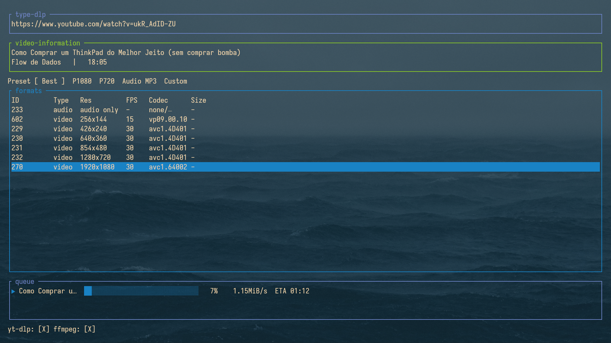

# type-dlp

A terminal user interface (TUI) for [yt-dlp](https://github.com/yt-dlp/yt-dlp), written in Rust with [ratatui](https://ratatui.rs).

Paste a URL, pick a quick preset or a specific format, and watch your downloads run in a queue with real-time progress, all without leaving the terminal.



## Features

- Fetches video info (title, channel, duration) and lists the available formats
- Quick presets: **Best**, **1080p**, **720p**, **Audio MP3**, and **Custom** (the row selected in the formats table)
- Download queue: downloads run one at a time in a background thread, so the interface never freezes
- Real-time progress bar, speed and ETA for the current download
- Output merged into `.mp4`
- Status bar showing whether `yt-dlp` and `ffmpeg` were found

## Requirements

- [yt-dlp](https://github.com/yt-dlp/yt-dlp) installed and available in your `PATH`
- [ffmpeg](https://ffmpeg.org) installed and available in your `PATH` (needed to merge video and audio, and for MP3 conversion)
- [Rust](https://www.rust-lang.org/tools/install) (only if you build from source)

## Installation

Use the installer script to install `ffmpeg`, `yt-dlp` and `type-dlp` into `/usr/local/bin`.

```bash
curl -fsSL https://raw.githubusercontent.com/CarlosGabellini/type-dlp/master/install.sh | bash
```

## Update

```bash
curl -fsSL https://raw.githubusercontent.com/CarlosGabellini/type-dlp/master/install.sh | bash -s -- --update
```

This updates `yt-dlp` and `type-dlp`. On Debian/Ubuntu and Fedora it also upgrades `ffmpeg`; on Arch-based systems, update `ffmpeg` with your regular system upgrade (`sudo pacman -Syu`).

## Uninstall

```bash
curl -fsSL https://raw.githubusercontent.com/CarlosGabellini/type-dlp/master/install.sh | bash -s -- --uninstall
```

This removes `type-dlp` and `yt-dlp` from `/usr/local/bin`. `ffmpeg` is left untouched, since other programs may use it.

### From source

```bash
git clone https://github.com/CarlosGabellini/type-dlp.git
cd type-dlp
cargo build --release
./target/release/type-dlp
```

### With cargo

```bash
cargo install --git https://github.com/CarlosGabellini/type-dlp
```

## Usage

Run `type-dlp` in your terminal.

1. Type or paste a video URL and press `Enter` to fetch its info.
2. Press `Tab` to move to the presets, choose one with `←` / `→` and press `Enter` to add it to the queue.
3. Or press `Tab` again to move to the formats table, choose a row with `↑` / `↓` and press `Enter`.
4. The queue starts on its own and downloads one item at a time.

Files are saved in your system's Videos folder (or the current directory if it can't be found).

### Keybindings

| Key | Action |
|---|---|
| `Tab` / `Shift+Tab` | Next / previous panel |
| `Enter` (URL) | Fetch video info |
| `←` / `→` (Presets) | Change preset |
| `↑` / `↓` (Formats) | Move through formats |
| `Enter` (Presets / Formats) | Add the download to the queue |
| `Esc` | Quit |

## Presets

| Preset | What it does |
|---|---|
| Best | Best available video + audio |
| P1080 | Best quality up to 1080p |
| P720 | Best quality up to 720p |
| Audio MP3 | Extracts the audio and converts to MP3 (requires `ffmpeg`) |
| Custom | Uses the format selected in the formats table |

## Built with

- [ratatui](https://ratatui.rs): terminal UI
- [serde](https://serde.rs) / serde_json: parsing the `yt-dlp -J` output
- [dirs](https://crates.io/crates/dirs): locating the Videos folder

## Disclaimer

This tool is only a front-end for yt-dlp. Download only content you have the right to download, and respect the terms of service of the sites you use.

## License

MIT License, see more in the [LICENSE](LICENSE) file.